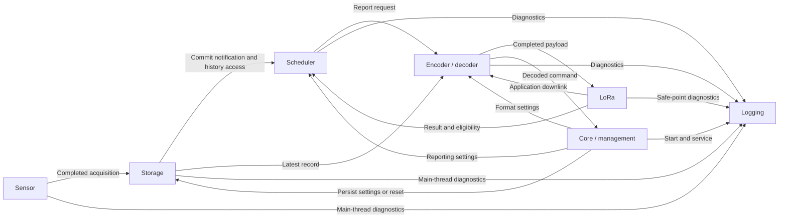

# Obedient Monitoring Thermistor — Software Constitution

**Revision:** 6 
**Established:** October 23, 2026 (America/Chicago)  
**Updated:** October 25, 2026 (America/Chicago) 
**Status:** Owner authorized implementation against the wizard decisions. Engineering work is
identified in [Section 12](#12-decisions-and-remaining-engineering-work).

## 1. Purpose and authority

This document defines how the environmental monitor is intended to function.
It is the shared design reference for development, reviews, bug checks, and
future changes. It describes the target design, not a claim that the current
firmware already implements every requirement.

Agreed requirements in this document guide implementation. The decision register
records the selected behavior; its engineering work items identify specifications
and verification still needed before the affected code or protocol changes.

Firmware implementation is now authorized in reviewable steps against this
design. Previously started, unpublished drafts
do not establish design decisions and must be reconciled with this document
before use.

When behavior needs to change, discuss the change, amend this document, then
implement and verify it in logical steps. A bug fix that restores documented
behavior does not require inventing a new design. Keep the amendment history
updated so later work can distinguish intentional changes from regressions.

Existing operational references describe the current firmware and wire format:

- [SENSOR_TEST.md](SENSOR_TEST.md): hardware, dependencies, build setup, and testing.
- [ENVIRONMENT_PACKET.md](ENVIRONMENT_PACKET.md): deployed packet/decoder contract.

Update those references alongside implementation. This constitution does not
silently change the meaning of an existing packet version.

## 2. Product and engineering principles

The device measures its environment and reports over LoRaWAN/Helium. Current
hardware is the SparkFun expLoRaBLE/Apollo3 with a Waveshare BME688. Bosch BSEC2
provides the derived air-quality estimates.

The firmware shall:

- Keep acquisition, history, scheduling, encoding, radio work, Serial logging, and management
  behind clear service interfaces.
- Continue collecting measurements independently of RF reporting frequency.
- Preserve every supported measurement; validity is explicit, and zero is not
  a substitute for "unavailable."
- Use available data and automatic learning without user-maintained thresholds
  for individual measurements.
- Use fixed, bounded RAM for history, with no sensor-history writes to flash.
- Remain correct across timer rollover and ordinary radio/sensor failures.
- Use exactly one public `.h` and one implementation `.cpp` per service, plus
  `common.h/.cpp` for shared programming. Do not create sub-service source/header
  pairs or move implementation into additional included source fragments.
- Work with unmodified third-party libraries and Arduino core source. Supported
  build configuration, including the BSEC linker override, is permitted.

## 3. Service boundaries

There are **seven services**. Each owns one combined `.h/.cpp` pair. Supporting
implementation belongs inside its owning service's `.cpp`, with private helpers
and classes as needed; there are no separately compiled sub-services.

| Service | Owns | Boundary |
| --- | --- | --- |
| Core/management | Overall state machine; startup and graceful shutdown; clock/crystal initialization and verification; active application settings; application-command validation and application | Does not implement acquisition, packet serialization, adaptive deadlines, or direct EEPROM/flash I/O |
| Scheduler | Dynamic/fixed reporting policy; history analysis; startup reporting gates; next-report deadlines; initiating reports; application retry pacing | Does not read the sensor, serialize packets, access EEPROM directly, or control precise radio receive-window timing |
| Encoder/decoder | Reading active format preferences and stored measurements; packet construction; handing completed packets to LoRa; parsing application downlink bytes | Does not choose reporting deadlines, persist settings, or run radio recovery |
| LoRa | Radio initialization; activation; joins/rejoins; transmission; Class A receive windows; protocol eligibility; radio recovery; transaction results | Does not choose the application's dynamic/fixed reporting policy or perform application settings changes |
| Storage | EEPROM/flash initialization and I/O; application settings records; calibration-state persistence; nonce journal and durable reservations; RAM ring and consistent access | Does not interpret sensor calibration, decide when to report, or operate the radio |
| Sensor | Sensor bus access; acquisition; BSEC processing; validation; calibration/readiness logic; providing completed records and calibration blobs | Does not schedule RF reports or access EEPROM/flash directly |
| Logging | Serial initialization; runtime verbosity subject to a build-time ceiling; message formatting; bounded queueing; severity-aware overflow accounting; nonblocking, time/byte-bounded draining and Serial backpressure | Serial only; does not write files/flash, acquire measurements, schedule RF, or perform radio protocol work |

### Required source layout

| Files | Responsibility |
| --- | --- |
| `core_service.h/.cpp` | Core/management, including private crystal timing implementation |
| `sensor_service.h/.cpp` | Sensor acquisition, BSEC worker, validation, and calibration decisions |
| `storage_service.h/.cpp` | RAM ring and all private EEPROM, calibration-record, and nonce-journal backends |
| `scheduler_service.h/.cpp` | Reporting policy and deadlines |
| `encoder_service.h/.cpp` | Packet encoding and application command decoding |
| `lorawan_service.h/.cpp` | LoRa lifecycle, private Apollo3 HAL, crystal-radio startup, and rollover guards |
| `log_service.h/.cpp` | Cooperative Serial logging state machine |
| `common.h/.cpp` | Shared data structures, enums, compile-time feature definitions, and small pure validation/conversion helpers |

Service headers expose public contracts. Keep internal helpers, classes, and
state private to the owning implementation. `common.*` is shared programming,
not an eighth service: it must not own hardware, threads, mutable service state,
persistent I/O, startup, radio recovery, or reporting policy. Include dependencies
must remain acyclic; do not use common as a container for unrelated code.

The Arduino `.ino` entry point, immutable `config.h`, and factory
`settings_defaults.h` remain separate. Tests, tools, reference sketches, and
unmodified third-party dependencies are outside this production-file rule.
Other production support headers/pairs must be folded into the service or
common pair that owns them; do not leave compatibility shims for removed files.

Logging is another cooperative state-machine bolt-on serviced by core's main
loop. It does not require its own RTOS thread. Acquisition workers and ISRs must
not call the Serial sink or contend on its queue; main formats/emits diagnostics
at safe points. Logging state must reflect disabled, idle, queued, and
backpressured operation while preserving bounded work and radio timing.

Core owns the system clock/crystal reference. Scheduler uses that time source;
it does not create or calibrate another clock. RadioLib continues to own precise
LoRaWAN protocol timing through the LoRa service.

### Main handoffs

LoRaWAN MAC commands remain RadioLib/LoRa work. Application settings downlinks
follow the decoder/management path.

## 4. Acquisition and RAM history

BSEC retains its required internal acquisition cadence, approximately **three
seconds**. Each completed acquisition goes **directly into the storage ring**.
There is no additional once-per-minute snapshot publishing stage.

Each record contains a coherent set of measurements from one acquisition, its
acquisition time, field validity, and BSEC accuracy/readiness indicators. The
seven supported measurements are:

1. Temperature.
2. Relative humidity.
3. Pressure.
4. Raw gas resistance.
5. Bosch IAQ.
6. CO2-equivalent.
7. Breath-VOC-equivalent.

Use compensated temperature/humidity when available and identify that status.
Derived estimates may be present while accuracy is still zero; availability
and calibration confidence are different properties. CO2-equivalent and
breath-VOC-equivalent are algorithmic estimates, not direct gas measurements.

The ring retains **one hour of history**, nominally **1,200 records** at a
three-second cadence. It has fixed capacity and replaces the oldest records as
new acquisitions arrive. Final record layout and RAM usage must be checked
against the board's full memory budget before implementation is accepted.

Storage provides consistent copies/access while acquisition and reporting run
concurrently. Consumers must not observe partially written records. Missing
acquisitions must not be fabricated or backfilled as successful readings.

After committing a complete record, storage notifies scheduler that new data is
available. The notification must not expose a partially committed record or
make sensor acquisition wait for radio work. In dynamic mode scheduler evaluates
the ring in response. In fixed mode it does not perform adaptive analysis for
every commit; it uses the ring when a report is due or being prepared. Acquisition
and ring commits continue in either mode. Scheduler timers remain operational
even if no new records arrive, so missing-data/status reports still occur.

The ring is RAM-only. A reboot or power loss discards it. Radio recovery alone
does not discard history or restart acquisition. Reading failures are surfaced
through validity, sensor status, and acquisition age/gaps. The ring is the
measurement history used by the dynamic algorithm; there is no separate
last-reported-value baseline or duplicate measurement history to maintain.

## 5. Startup and reporting gates

Core initializes and verifies the clock reference and initializes storage.
Radio operations must not proceed with failed clock verification or unsafe
nonce persistence. Invalid application settings may fall back to defaults;
that is not permission to erase nonce history.

Core starts LoRa during initialization after crystal timing is verified and
storage prerequisites are satisfied. Joining may proceed whenever practical,
independently of sensor learning. Joining and reporting must not determine the
sensor acquisition cadence.

The scheduler begins learning with the **first usable reading**. The startup
learning window is **six minutes of elapsed time** from that reading, nominally
about 120 three-second acquisitions, not six three-second records.

The first sensor transmission requires all of the following:

1. The node is joined and LoRa permits transmission.
2. The six-minute learning window has elapsed.
3. A fresh, coherent record has **all seven measurements available**. BSEC
   calibration accuracy may still be zero; highest accuracy is not required.

Do not add a separate fixed 60-second post-join settling delay. RadioLib still
owns its protocol timing and eligibility checks. Adaptive scheduling must not
begin changing RF deadlines until the startup gate and the **first successful
sensor-payload transaction** have both completed.

If the startup sensor-data gate cannot be satisfied, the joined node sends
health/status packets while waiting: every **six minutes in dynamic mode**, or
at the **selected reporting interval in fixed mode**. These packets contain
device status, do not stand in for a complete first sensor report, and do not
enable adaptive scheduling. They must remain possible even if no usable sensor
reading has arrived to start the learning clock.

For this gate, health/status packets, command replies, and MAC-only exchanges do
not count as the first sensor transmission.
A successful unconfirmed transaction means local completion, not proof of
receipt by the network. Do not require confirmed uplinks merely to establish
this gate.

## 6. Scheduler behavior

### Modes

- **Dynamic:** learn from available measurements and vary the reporting interval.
- **Fixed:** use the selected integer interval, **1–60 minutes**.

Scheduler reads validated active settings in RAM. Storage owns loading and
saving those settings; scheduler does not read EEPROM on each evaluation.

### Dynamic behavior

The preferred baseline is **six minutes**. Target intervals range from **one
minute to one hour**. Calculate behavior from the live acquisition history in
the ring. Repeated unusual results and sustained fast movement should
progressively shorten intervals; fewer unusual results and steadier behavior
should favor longer intervals.

Use a **linear activity-to-interval mapping**: bound the highest available
metric activity score to **1–60**, retaining fractional values, then calculate
`target interval in minutes = 61 - activity score`. Scores of 1, 6, 30, and 60
request 60, 55, 31, and 1 minutes respectively. Activity below 1 requests one
hour; activity above 60 requests one minute. Keep the existing history-based
scoring, metric influence, median filtering, availability handling, and elapsed-time
schedule smoothing. The six-minute baseline still governs startup and
insufficient-history fallback; it is not the center of the linear mapping.

**One unexpected reading must not wildly swing reporting timing.** Use the
surrounding history and persistence of change to moderate outliers. Evaluate
available measurements independently so sustained activity in a valid field is
not hidden by steady or unavailable fields. No manually edited per-metric
thresholds are required.

Select one reporting schedule for the combined report. Do not require a
separate comparison with values in the last transmitted packet. Scheduler
still retains transmission times, deadlines, and necessary control state to
enforce cadence; those are not another sensor history.

Calculations must use acquisition times and actual elapsed time. Changing the
number of records per minute must not silently redefine a rate of change.
Choose and document bounded mathematics, smoothing, and confidence rules during
the implementation specification. They must satisfy these agreed behaviors and
the acceptance cases in Section 11, without introducing new user-facing tuning.

### Availability and insufficient data

After the first complete sensor report, continue sending available measurements
when some fields are unavailable. Flag missing fields explicitly. Availability
changes may bring a report forward within the cadence limits; they must not
turn a single transient observation into an uncontrolled timing swing.

If all sensor measurements are unavailable after startup, report health/status
every **six minutes in dynamic mode**. In **fixed mode**, honor the selected
interval instead of overriding it with six minutes. Sensor recovery continues
independently, and scheduler timers must not depend on ring commit notifications
to detect that a report is due.

When history is insufficient to support adaptation, use the six-minute baseline
in dynamic mode rather than inventing precision or learning from invalid data.
Fixed mode continues to honor its interval. Define and test data-age and gap
criteria in the implementation specification; stale values are unavailable,
never fresh readings replayed from an earlier ring entry.

### Report requests and outcomes

When a report is due, scheduler initiates the encoder. LoRa may defer the
transaction if it is not joined or transmission is not permitted. LoRa returns
the outcome and relevant eligibility information; scheduler plans the next
application attempt.

Queued command replies may use the next eligible application uplink before a
normal sensor report is due. A command reply does not reset the normal
sensor-report deadline. Regular health packets occupy the selected reporting
slots in fixed mode, so sensor loss/recovery does not cause extra early reports.
Neither command replies nor health packets satisfy the first-sensor-report gate.

Space application uplink attempts at least **one minute** apart, including
retries after uncertain failures. RadioLib can perform protocol-required work
inside its transactions; this application rule must not be implemented by
patching the library.

One hour is the maximum desired reporting interval during normal operation.
RF eligibility, network loss, recovery, or other faults can delay actual
delivery; a deadline does not authorize bypassing LoRaWAN restrictions.

Keep history and learned behavior during radio recovery. Both start fresh on
reboot. Scheduler does not create a backlog of transmissions for missed
deadlines.

## 7. Encoding, units, and delivery

On a scheduler request, encoder takes a consistent copy of active format
settings and the newest stored record, builds the packet, and hands the
completed payload to LoRa. Acquisition continues independently.

Sensor reports carry all seven measurements, validity/readiness indicators,
acquisition time, and the selected presentation-unit preferences. Preserve
full unsigned gas-resistance representation and the previously selected
32-bit breath-VOC-equivalent precision.

Binary measurements retain canonical units: Celsius, relative-humidity
percent, pascals, ohms, and ppm for the equivalent gas outputs. Chosen
presentation units control formatted Serial output and decoded presentation.
The receiving decoder obtains the unit preferences through the reporting
protocol; it must not have to guess whether measurement values changed units.

Keep field validity explicit. Do not present stale values as fresh or interpret
an invalid slot's zero as a measurement. If current radio capacity cannot fit a
complete sensor report, **defer that complete report**, service MAC-only
transactions when needed, and retry when permitted. Do not drop fields or split
the sensor report into fragments. This retains the latest-record reporting
model, not a backlog of old encoded reports. Encoding/capacity errors must be
reported to the owning services for handling.

The existing 24-byte v2 packet is the deployed baseline, not a promise that new
preference/status metadata fits that unchanged format. Define versioning, layout,
command/response types, decoder migration, and capacity checks as engineering
specifications before changing the protocol. MQTT integration continues to
receive decoded sensor data. Wire-level assignments must preserve the functional
choices in this document; they are not permission to change those choices.

## 8. Configuration and application settings

| File/store | Purpose |
| --- | --- |
| `config.h` | Immutable firmware configuration: board pins, radio/LoRa settings, provisioning credentials, and other values outside the OTA application-settings interface |
| `settings_defaults.h` | Factory defaults for OTA-adjustable application settings |
| `common.h/.cpp` | Shared runtime settings structure, value definitions, and pure validation helpers |
| RAM | Active validated settings and current adaptive learning state |
| Persisted settings record | Accepted application preferences restored at startup |

The common pair defines the settings contract; core owns active settings and
storage owns the persisted record. Shared declarations do not transfer service
ownership to common.

Load valid saved settings at startup. Missing, corrupt, or incompatible
application settings use the applicable defaults. Define schema migration
before changing persisted layouts. Firmware updates to factory defaults do
not silently overwrite valid saved user preferences.

OTA commands persist accepted preferences through storage and then change active
settings, according to the transaction rules in Section 9. They do not rewrite
either configuration header. Learning a new dynamic interval does not itself
constitute a new persisted user setting.

### Agreed settings and defaults

| Setting/output | Choices | Factory default |
| --- | --- | --- |
| Reporting mode | Dynamic or fixed | Dynamic |
| Fixed reporting interval | Integer minutes 1–60 | 6 minutes |
| Dynamic reporting | Automatic, bounded 1–60 minutes | Preferred baseline 6 minutes |
| Temperature presentation | Celsius or Fahrenheit | Fahrenheit |
| Pressure presentation | hPa/mbar, Pa, kPa, inHg, mmHg | inHg |
| Humidity | Fixed %RH | %RH |
| Gas resistance presentation | Ohms or kilohms | Ohms |
| Bosch IAQ | Fixed 0–500 index, with accuracy/readiness | Same |
| CO2-equivalent | Fixed ppm | ppm |
| Breath-VOC-equivalent presentation | ppm or ppb | ppb |
| Serial verbosity | OFF, ERROR, WARN, INFO, DEBUG, TRACE | INFO |

hPa and mbar have identical numeric values and may share an encoded choice.
The fixed outputs do not need invented alternate-unit settings.

## 9. OTA application commands

The application command interface shall support:

- Setting reporting mode and the fixed reporting interval.
- Setting the presentation preferences and Serial verbosity listed above.
- **Get configuration:** return the active application settings.
- **Get status:** return uptime, sensor/BSEC readiness, radio state, ring usage,
  and current reporting interval.
- **Reset application settings:** load factory application defaults while
  preserving calibration and nonce history.
- **Emergency factory reset:** request a challenge, then confirm the reset using
  that challenge before any destructive work begins.
- **Remote reboot:** request a separate challenge, then confirm it before a
  clean restart that preserves all persisted settings, calibration, and nonce history.

Decoder owns byte-level parsing and format validation. Management owns semantic
validation and applying the decoded command. Storage owns durable I/O.

### Settings transactions and reply timing

Allow one downlink to change several application settings together. Validate the
**entire batch** before applying it. Invalid settings reject the whole batch;
do not apply a subset of its valid fields.

Save and verify the proposed settings before activating them. If persistence or
readback verification fails, **reject the batch, retain the existing active
settings, and report the save failure**. Do not activate temporary RAM-only
settings as though the command succeeded. The active-settings transaction is
all-or-nothing; any power-loss guarantees for the physical storage procedure
must be specified and tested rather than assumed.

When a batch changing reporting mode or interval is successfully accepted,
**start a fresh reporting interval from acceptance time**. Do not calculate the
new deadline from the previous sensor transmission, and do not keep an old
deadline for one more report. Preserve acquisition, ring history, and the
startup gates. Format-only changes do not implicitly restart reporting timing.

Queue an accepted/rejected result for a settings command, or the requested
configuration/status reply, for the **next eligible application uplink**, even
if the next normal sensor-report deadline is later. Such replies obey radio
eligibility and the one-minute minimum between application uplink attempts.
This gives Class A control responses an opportunity without changing the
configured normal sensor cadence.

Exact command identifiers, response layouts, request correlation, and queue
handling are engineering specifications to document before protocol changes.

### Emergency factory reset: request and confirmation

The initial factory-reset request **does not authorize an immediate wipe**.
Management enters a pending-confirmation state and generates a random
**six-digit reset confirmation code**. Encoder/LoRa send that code in a queued
challenge reply at the next eligible opportunity.

Keep the pending code and reset-request state **in RAM only**. The confirmation
period is **two hours total from receipt of the initial request**, including
challenge delivery time. Repeating the same request must not silently extend
that deadline.

During the confirmation period:

- **Continue normal sensor reports and normal acquisition/ring storage.** Do not
  pause reports, accelerate the sensor schedule, or create reset-polling uplinks.
- Remain in the existing Class A operating model. Receive the confirmation in
  ordinary downlink windows opened by uplinks; do not introduce continuous
  listening or require a Class C/library change.
- Require a second reset command carrying the matching code for the current,
  unexpired request. An invalid or expired code must not erase anything.
- On timeout, invalidate the code and abandon the reset without erasing data.
  Normal operation continues with its current settings and reporting schedule.
- On reboot, the RAM-only challenge is lost; an old confirmation must not cause
  a wipe without a current matching request.

The node does not promise a confirmation receive opportunity before expiry:
normal reports may be an hour apart, and RF eligibility/failures may delay them.
The selected design intentionally does not add polling to avoid that possibility.
An unconfirmed request simply expires without a reset.

### Emergency factory reset: confirmed execution

Only after valid confirmation:

1. Stop active work cleanly.
2. Erase and verify persisted application settings, BSEC calibration, and nonce
   history through storage.
3. Clear RAM history, adaptive learning, session state, pending commands, and
   the reset challenge.
4. Load application defaults.
5. Restart normal startup/join behavior using unchanged `config.h`.

Erases have a **bounded retry limit**. If a required store repeatedly fails
verification, stop radio work and report the failure on Serial until the device
is serviced/restarted. Do not announce a successful reset, continue indefinitely
retrying erasures, or resume radio work against unverified reset state.

**Do not retain a reset marker or a persistent record that the wipe occurred.**
Compiled configuration and firmware remain intact. Restarting normal join
behavior does not guarantee acceptance by the network: the same compiled OTAA
credentials remain while nonce history has been erased. This consequence and
the choice to retain no reset marker were explicitly accepted.

The ordered erase procedure and retry counts must be specified and tested
before implementation. Because there is no persistent reset marker, an
interrupted erase has no promise of automatic reset resumption or rollback;
the next boot uses normal storage integrity checks and startup behavior.

### Remote reboot: request and confirmation

Reboot uses the same RAM-only random six-digit challenge, **two-hour deadline
from the initial request**, ordinary reporting/Class A windows, duplicate-request
handling, and expiry rules as factory reset. Only one reboot or factory-reset
challenge may be pending; another request returns busy. Confirmation must match
both the pending operation and its code: a reboot confirmation cannot authorize
a factory erase, and a factory-reset confirmation cannot authorize a reboot.

After valid reboot confirmation, stop radio work and cooperatively stop sensor
acquisition, then restart the MCU **without erasing or replacing any persisted
data**. A stop timeout leaves radio work halted and reports the failure on Serial.
No final RF acknowledgement is required before restart. Ordinary RAM/session
state is lost as on a normal restart; startup restores the saved application
settings and calibration and uses retained nonce history for a fresh OTAA join.

## 10. Calibration, persistence, and diagnostics

Sensor owns calibration meaning: BSEC processing, accuracy/readiness tracking,
compatibility decisions, and deciding when state is worth saving. It exports
the calibration blob and requests persistence from storage. On startup it
requests the stored blob and restores compatible state into BSEC.

Storage owns the blob's physical location, reads/writes, and storage integrity
checks. Sensor calibration is not a storage algorithm. Do not move Bosch calls
or calibration decisions into storage merely because state is persisted there.

Application settings and calibration share the designated emulated EEPROM
area through storage APIs with non-overlapping records. LoRa nonce history uses
its separate flash journal. Normal settings/calibration writes and ordinary
recovery must preserve nonce history. LoRa requests a durable nonce reservation
before an applicable join attempt; storage owns its persistence mechanics.

Logging means **Serial output only**, using the common verbosity levels. No
text log files or persistent sensor-history logging are part of this design.
Logging must not determine sampling correctness or radio receive-window timing.
The logging service owns its cooperative queue/drain state machine, including
backpressure and dropped-message accounting. A reduced compile-time ceiling caps
output without invalidating saved preferences or unrelated OTA settings.

No blocking Serial, EEPROM/flash operations, or other mutex-using work belongs
in an ISR. Define safe concurrency and bounded service access when implementing
the acquisition-to-ring handoff. A sensor failure must not automatically force
a radio rejoin; each service reports its own condition for appropriate handling.

## 11. Planned implementation order and acceptance

When firmware implementation is requested, work in reviewable steps:

1. Establish shared data/settings contracts and seven-service interfaces with
   exactly the source layout in Section 3.
2. Separate immutable configuration, defaults, active settings, and storage I/O.
3. Connect completed sensor acquisitions directly to the one-hour ring; verify
   RAM usage, record consistency, and calibration-state handoffs.
4. Implement scheduler ownership, agreed startup gates, and fixed reporting.
5. Implement and validate the agreed adaptive behavior against recorded or
   generated stable, noisy, trending, abrupt-change, and missing-data streams.
6. Add versioned preference metadata, OTA commands, responses, persistence, and
   reset behavior with the matching decoder changes.
7. Run expanded firmware logic checks and physical board/network tests.

Checks shall cover service ownership, startup gates, unavailable data, ring
overwrite/concurrency, timer rollover, reporting bounds, MAC-only transactions,
RF deferral/failures/recovery, settings validation/restoration, calibration
restoration, decoder compatibility, and deliberate reset behavior.

In particular, acceptance must demonstrate:

- Exactly seven service pairs plus common, private supporting implementations,
  acyclic header contracts, and no production sub-service files/source fragments.
- Cooperative Serial logging states, bounded queue/pump work, disabled output,
  overflow accounting, and recovery from backpressure without timing changes.
- Six minutes of elapsed learning and availability of all seven fields before
  the first sensor packet, while allowing calibration accuracy zero.
- Startup health packets without accidentally opening the adaptive gate.
- Commit notifications after complete writes, dynamic evaluation on new data,
  and fixed-mode deadlines that continue even when no data arrives.
- Limited timing influence from one outlier, progressively faster reporting
  for sustained unusual/fast changes, and slower reporting for steady streams.
- Partial-field reporting after startup, with six-minute total-failure health
  reports in dynamic mode and the selected interval in fixed mode.
- A fresh interval on accepted mode/interval changes; no active settings changes
  when batch validation, saving, or verification fails.
- Prompt queued command replies without violating the RF-attempt minimum.
- Complete-report deferral rather than truncation or fragmentation.
- Six-digit reset/reboot challenges, the two-hour request-origin expiry, continued
  ordinary reports without polling, rejection of wrong/expired/stale codes,
  operation-specific confirmation, persisted-data preservation on reboot,
  verified complete factory erasure, and radio halt after bounded erase failures.

A successful compile is not proof of physical sensor/radio behavior. Keep
host/build evidence and board/network observations distinct. Do not modify
third-party source to make the tests pass.

## 12. Decisions and remaining engineering work

The functional choices raised in the design wizard are recorded below. The
remaining work specifies and verifies how to implement them; it must not
silently substitute a different functional choice.

| ID | Selected behavior | Required engineering work |
| --- | --- | --- |
| D1 — Startup | Learn for six minutes from the first usable reading. Require all seven measurements for the first sensor report, allowing accuracy zero. Start LoRa after crystal verification; no extra fixed post-join delay. Status packets do not unlock adaptation. | Define freshness and timestamp handling, gate state transitions, and consistent availability checks. |
| D2 — Dynamic and missing data | Direct three-second records into a one-hour ring, with commit notifications. Derive behavior from ring history without a separate last-reported-value baseline. Moderate individual outliers; sustained unusual/fast activity increases reporting and steady streams reduce it. Allow partial reports after startup. All-unavailable and startup-wait status follows six minutes in dynamic mode or the selected interval in fixed mode. | Specify bounded calculations, smoothing/confidence, freshness/gap handling, and scenario-based acceptance cases; measure RAM/CPU/concurrency costs. |
| D3 — Packets and OTA delivery | Atomic validated settings batches. Queue results/replies for the next eligible uplink even ahead of normal sensor reports. Defer complete sensor reports for capacity and service MAC exchanges as needed; do not truncate or fragment them. Preserve canonical values, preferences, and all measurements. | Specify versioned report/control layouts, command and response identifiers, request correlation, bounded queues, capacity checks, and decoder migration before changing deployed wire behavior. |
| D4 — Settings, reset, and reboot | Save/verify settings before activation; on failure keep existing active settings and report rejection. Accepted mode/interval changes start a fresh interval. Factory reset and reboot require operation-specific six-digit challenges and matching second commands within two hours from the initial request. Only one challenge may be pending. Continue normal reporting without polling. Confirmed reboot preserves every persisted store; confirmed factory reset erases/verifies everything designated. Bounded erase failure stops radio and is reported on Serial. No persistent reset marker. | Specify persistence/erase ordering, retry limits, request handling, and interrupted-write behavior consistent with the chosen RAM-only confirmation and marker-free reset; verify reboot preservation and cross-operation rejection before enabling commands. |
| D5 — Source organisation and logging | Seven services, including cooperative Serial-only logging. Exactly one combined .h/.cpp pair per service; no sub-service pairs or source fragments. common.h/.cpp holds shared contracts and pure helpers. Keep the Arduino entry point, immutable config and factory defaults separate. | Consolidate supporting implementations privately, enforce the file/header boundaries, exercise logging states and timing bounds, and verify crystal timing/radio startup preservation with host and board checks. |

The one-hour ring and factory defaults remain agreed. Record sizing is an
implementation feasibility check. If implementation would require a functional
compromise or a new product decision, amend this document before making it.

## 13. Amendment history

| Revision | Date (America/Chicago) | Change |
| --- | --- | --- |
| 1 | 2026-10-23 | Established six services, direct three-second acquisition-to-ring flow, one-hour RAM history, canonical measurement units with presentation preferences, factory defaults, calibration/persistence boundaries, OTA command scope, and marker-free complete reset. Kept unresolved startup, adaptive, protocol, and failure behaviors explicit. |
| 2 | 2026-10-23 | Recorded wizard decisions for six-minute/all-seven startup, ring commit notifications and ring-based adaptive behavior, mode-specific health cadence, atomic saved settings, fresh intervals, prompt replies, complete-report deferral, and a RAM-only six-digit factory-reset challenge with one-hour expiry, ordinary reporting without polling, and bounded erase-failure halt. Separated resolved functional direction from required engineering specifications. |
| 3 | 2026-10-23 | Owner authorized the firmware rewrite. Clarified that fixed-mode health packets occupy normal reporting slots through sensor loss/recovery; separate command replies do not reset sensor deadlines. No factory defaults or reset-confirmation choices changed. |
| 4 | 2026-10-24 | Added logging as the seventh service with explicit cooperative Serial queue, verbosity, overflow, and backpressure ownership. Required one combined header/implementation pair per service, no sub-service pairs or source fragments, and common.h/.cpp for shared contracts/pure helpers. Preserve the Arduino entry point, immutable config, factory defaults, crystal discipline, and working crystal-radio startup during consolidation. |
| 5 | 2026-10-24 | Extended the factory-reset confirmation window to two hours and added a separate two-step remote reboot with the same deadline and Class A delivery rules. Permit one pending operation, bind confirmation to its operation, and preserve all persisted data on reboot. |
| 6 | 2026-10-25 | Owner authorized a trial of linear dynamic reporting: bound activity to 1–60 and use `61 - activity` minutes. Preserve three-second acquisition, history scoring, metric influence, startup/fallback gates, availability handling, and existing schedule smoothing. |
