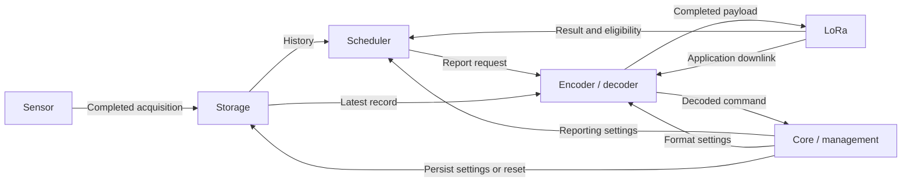

# Obedient Monitoring Thermistor — Software Constitution

**Revision:** 1  
**Established:** October 23, 2026 (America/Chicago)  
**Status:** Agreed architectural and functional direction, with open decisions
explicitly identified in [Section 12](#12-open-decisions).

## 1. Purpose and authority

This document defines how the environmental monitor is intended to function.
It is the shared design reference for development, reviews, bug checks, and
future changes. It describes the target design, not a claim that the current
firmware already implements every requirement.

Agreed requirements in this document guide implementation. Suggestions in the
open-decisions register are not approved requirements. Resolve an open decision
before implementing behavior that depends on it.

Implementation remains paused until the functional design is fully agreed.
Previously started, unpublished implementation drafts do not establish design
decisions and must be reconciled with this document before use.

When behavior needs to change, discuss the change, amend this document, then
implement and verify it in logical steps. A bug fix that restores documented
behavior does not require inventing a new design. Keep the amendment history
updated so later work can distinguish intentional changes from regressions.

Existing operational references describe the current firmware and wire format:

- [SENSOR_TEST.md](SENSOR_TEST.md): hardware, dependencies, build setup, and testing.
- [ENVIRONMENT_PACKET.md](ENVIRONMENT_PACKET.md): deployed packet/decoder contract.

Update those references alongside implementation. This constitution does not
silently change the meaning of an existing packet version.

## 2. Product and engineering principles

The device measures its environment and reports over LoRaWAN/Helium. Current
hardware is the SparkFun expLoRaBLE/Apollo3 with a Waveshare BME688. Bosch BSEC2
provides the derived air-quality estimates.

The firmware shall:

- Keep acquisition, history, scheduling, encoding, radio work, and management
  behind clear service interfaces.
- Continue collecting measurements independently of RF reporting frequency.
- Preserve every supported measurement; validity is explicit, and zero is not
  a substitute for "unavailable."
- Use available data and automatic learning without user-maintained thresholds
  for individual measurements.
- Use fixed, bounded RAM for history, with no sensor-history writes to flash.
- Remain correct across timer rollover and ordinary radio/sensor failures.
- Preserve standard `.h`/`.cpp` splits for firmware modules.
- Work with unmodified third-party libraries and Arduino core source. Supported
  build configuration, including the BSEC linker override, is permitted.

## 3. Service boundaries

There are **six services**. A service may have multiple implementation modules;
that does not create another service or move its responsibilities elsewhere.

| Service | Owns | Boundary |
| --- | --- | --- |
| Core/management | Overall state machine; startup and graceful shutdown; clock/crystal initialization and verification; active application settings; application-command validation and application | Does not implement acquisition, packet serialization, adaptive deadlines, or direct EEPROM/flash I/O |
| Scheduler | Dynamic/fixed reporting policy; history analysis; startup reporting gates; next-report deadlines; initiating reports; application retry pacing | Does not read the sensor, serialize packets, access EEPROM directly, or control precise radio receive-window timing |
| Encoder/decoder | Reading active format preferences and stored measurements; packet construction; handing completed packets to LoRa; parsing application downlink bytes | Does not choose reporting deadlines, persist settings, or run radio recovery |
| LoRa | Radio initialization; activation; joins/rejoins; transmission; Class A receive windows; protocol eligibility; radio recovery; transaction results | Does not choose the application's dynamic/fixed reporting policy or perform application settings changes |
| Storage | EEPROM/flash initialization and I/O; application settings records; calibration-state persistence; nonce journal and durable reservations; RAM ring and consistent access | Does not interpret sensor calibration, decide when to report, or operate the radio |
| Sensor | Sensor bus access; acquisition; BSEC processing; validation; calibration/readiness logic; providing completed records and calibration blobs | Does not schedule RF reports or access EEPROM/flash directly |

Core owns the system clock/crystal reference. Scheduler uses that time source;
it does not create or calibrate another clock. RadioLib continues to own precise
LoRaWAN protocol timing through the LoRa service.

### Main handoffs

LoRaWAN MAC commands remain RadioLib/LoRa work. Application settings downlinks
follow the decoder/management path.

## 4. Acquisition and RAM history

BSEC retains its required internal acquisition cadence, approximately **three
seconds**. Each completed acquisition goes **directly into the storage ring**.
There is no additional once-per-minute snapshot publishing stage.

Each record contains a coherent set of measurements from one acquisition, its
acquisition time, field validity, and BSEC accuracy/readiness indicators. The
seven supported measurements are:

1. Temperature.
2. Relative humidity.
3. Pressure.
4. Raw gas resistance.
5. Bosch IAQ.
6. CO2-equivalent.
7. Breath-VOC-equivalent.

Use compensated temperature/humidity when available and identify that status.
Derived estimates may be present while accuracy is still zero; availability
and calibration confidence are different properties. CO2-equivalent and
breath-VOC-equivalent are algorithmic estimates, not direct gas measurements.

The ring retains **one hour of history**, nominally **1,200 records** at a
three-second cadence. It has fixed capacity and replaces the oldest records as
new acquisitions arrive. Final record layout and RAM usage must be checked
against the board's full memory budget before implementation is accepted.

Storage provides consistent copies/access while acquisition and reporting run
concurrently. Consumers must not observe partially written records. Missing
acquisitions must not be fabricated or backfilled as successful readings.

The ring is RAM-only. A reboot or power loss discards it. Radio recovery alone
does not discard history or restart acquisition. Reading failures are surfaced
through validity, sensor status, and acquisition age/gaps; the exact
all-measurements-unavailable reporting behavior remains open.

## 5. Startup and reporting gates

Core initializes and verifies the clock reference and initializes storage.
Radio operations must not proceed with failed clock verification or unsafe
nonce persistence. Invalid application settings may fall back to defaults;
that is not permission to erase nonce history.

Start sensor work and attempt the network join as soon as prerequisites permit.
Joining and reporting must not determine the sensor acquisition cadence.

The scheduler begins learning with the **first available reading**. The first
sensor transmission waits until the node is joined and the startup data gate
has been satisfied. Adaptive scheduling must not begin changing RF deadlines
until both the startup data gate and the **first successful sensor-payload
transaction** have completed.

**The startup data gate requires a final decision.** The original agreement was
six valid one-minute readings. Acquisition/storage has since changed to
three-second records, and six such records represent only about 15–18 seconds.
Retaining a six-minute learning window, approximately 120 records, was proposed
but has not been explicitly selected. See decision D1.

For this gate, MAC-only exchanges do not count as the first sensor transmission.
A successful unconfirmed transaction means local completion, not proof of
receipt by the network. Do not require confirmed uplinks merely to establish
this gate.

## 6. Scheduler behavior

### Modes

- **Dynamic:** learn from available measurements and vary the reporting interval.
- **Fixed:** use the selected integer interval, **1–60 minutes**.

Scheduler reads validated active settings in RAM. Storage owns loading and
saving those settings; scheduler does not read EEPROM on each evaluation.

### Dynamic behavior

The preferred baseline is **six minutes**. Target intervals range from **one
minute to one hour**. Unexpected or sudden changes should shorten reporting
intervals promptly; predictable or stable conditions should allow longer
intervals. Interval increases should be gradual enough to avoid oscillation.

The algorithm shall consider available valid measurements independently and
select one reporting schedule for the combined report. A missing gas or derived
estimate must not prevent available temperature/humidity/pressure from being
used. It must handle insufficient history and changing availability without
requiring manually edited thresholds for individual measurements.

Calculations must use acquisition times and actual elapsed time. Changing the
number of records per minute must not silently redefine a rate of change.
Exact mathematics, confidence rules, and fallback behavior remain to be agreed
before implementing the algorithm (D2).

### Report requests and outcomes

When a report is due, scheduler initiates the encoder. LoRa may defer the
transaction if it is not joined or transmission is not permitted. LoRa returns
the outcome and relevant eligibility information; scheduler plans the next
application attempt.

Space application uplink attempts at least **one minute** apart, including
retries after uncertain failures. RadioLib can perform protocol-required work
inside its transactions; this application rule must not be implemented by
patching the library.

One hour is the maximum desired reporting interval during normal operation.
RF eligibility, network loss, recovery, or other faults can delay actual
delivery; a deadline does not authorize bypassing LoRaWAN restrictions.

Keep history and learned behavior during radio recovery. Both start fresh on
reboot. Scheduler does not create a backlog of transmissions for missed
deadlines.

## 7. Encoding, units, and delivery

On a scheduler request, encoder takes a consistent copy of active format
settings and the newest stored record, builds the packet, and hands the
completed payload to LoRa. Acquisition continues independently.

Sensor reports carry all seven measurements, validity/readiness indicators,
acquisition time, and the selected presentation-unit preferences. Preserve
full unsigned gas-resistance representation and the previously selected
32-bit breath-VOC-equivalent precision.

Binary measurements retain canonical units: Celsius, relative-humidity
percent, pascals, ohms, and ppm for the equivalent gas outputs. Chosen
presentation units control formatted Serial output and decoded presentation.
The receiving decoder obtains the unit preferences through the reporting
protocol; it must not have to guess whether measurement values changed units.

Keep field validity explicit. Do not present stale values as fresh, interpret
an invalid slot's zero as a measurement, or silently discard measurements to
fit a smaller payload. Encoding/capacity errors must be reported to the owning
services for handling.

The existing 24-byte v2 packet is the deployed baseline, not a promise that new
preference/status metadata fits that unchanged format. Define versioning,
layout, decoder migration, and capacity checks before changing the protocol
(D3). MQTT integration continues to receive decoded sensor data.

## 8. Configuration and application settings

| File/store | Purpose |
| --- | --- |
| `config.h` | Immutable firmware configuration: board pins, radio/LoRa settings, provisioning credentials, and other values outside the OTA application-settings interface |
| `settings_defaults.h` | Factory defaults for OTA-adjustable application settings |
| `app_settings.h` | Shared runtime settings structure and related value definitions |
| RAM | Active validated settings and current adaptive learning state |
| Persisted settings record | Accepted application preferences restored at startup |

Header filenames describe the intended separation; creating the headers is an
implementation step, not a claim that they already exist in the deployed code.

Load valid saved settings at startup. Missing, corrupt, or incompatible
application settings use the applicable defaults. Define schema migration
before changing persisted layouts. Firmware updates to factory defaults do
not silently overwrite valid saved user preferences.

OTA commands change active settings and persist accepted preferences through
storage. They do not rewrite either configuration header. Learning a new
dynamic interval does not itself constitute a new persisted user setting.

### Agreed settings and defaults

| Setting/output | Choices | Factory default |
| --- | --- | --- |
| Reporting mode | Dynamic or fixed | Dynamic |
| Fixed reporting interval | Integer minutes 1–60 | 6 minutes |
| Dynamic reporting | Automatic, bounded 1–60 minutes | Preferred baseline 6 minutes |
| Temperature presentation | Celsius or Fahrenheit | Fahrenheit |
| Pressure presentation | hPa/mbar, Pa, kPa, inHg, mmHg | inHg |
| Humidity | Fixed %RH | %RH |
| Gas resistance presentation | Ohms or kilohms | Ohms |
| Bosch IAQ | Fixed 0–500 index, with accuracy/readiness | Same |
| CO2-equivalent | Fixed ppm | ppm |
| Breath-VOC-equivalent presentation | ppm or ppb | ppb |
| Serial verbosity | OFF, ERROR, WARN, INFO, DEBUG, TRACE | INFO |

hPa and mbar have identical numeric values and may share an encoded choice.
The fixed outputs do not need invented alternate-unit settings.

## 9. OTA application commands

The application command interface shall support:

- Setting reporting mode and the fixed reporting interval.
- Setting the presentation preferences and Serial verbosity listed above.
- **Get configuration:** return the active application settings.
- **Get status:** return uptime, sensor/BSEC readiness, radio state, ring usage,
  and current reporting interval.
- **Reset application settings:** load factory application defaults while
  preserving calibration and nonce history.
- **Emergency factory reset:** perform the complete reset below.

Decoder owns byte-level parsing and format validation. Management owns semantic
validation and applying the decoded command. Storage owns durable I/O.

Exact command bytes, response/status packets, application timing, persistence
failure handling, and the effect of changing reporting mode/interval on a
pending deadline remain to be defined in D3/D4.

### Emergency factory reset

The agreed reset sequence is:

1. Stop active work cleanly.
2. Erase persisted application settings, BSEC calibration, and nonce history.
3. Clear RAM history, adaptive learning, session state, and pending work.
4. Load application defaults.
5. Restart normal startup/join behavior using unchanged `config.h`.

**Do not retain a reset marker or a persistent record that the wipe occurred.**
Compiled configuration and firmware remain intact. Restarting normal join
behavior does not guarantee acceptance by the network: the same compiled OTAA
credentials remain while nonce history has been erased. This consequence and
the choice to retain no reset marker were explicitly accepted.

The ordered erase procedure, handling of an erase failure or interrupted reset,
and any response before reset must be specified before implementation (D4).

## 10. Calibration, persistence, and diagnostics

Sensor owns calibration meaning: BSEC processing, accuracy/readiness tracking,
compatibility decisions, and deciding when state is worth saving. It exports
the calibration blob and requests persistence from storage. On startup it
requests the stored blob and restores compatible state into BSEC.

Storage owns the blob's physical location, reads/writes, and storage integrity
checks. Sensor calibration is not a storage algorithm. Do not move Bosch calls
or calibration decisions into storage merely because state is persisted there.

Application settings and calibration share the designated emulated EEPROM
area through storage APIs with non-overlapping records. LoRa nonce history uses
its separate flash journal. Normal settings/calibration writes and ordinary
recovery must preserve nonce history. LoRa requests a durable nonce reservation
before an applicable join attempt; storage owns its persistence mechanics.

Logging means **Serial output only**, using the common verbosity levels. No
text log files or persistent sensor-history logging are part of this design.
Logging must not determine sampling correctness or radio receive-window timing.

No blocking Serial, EEPROM/flash operations, or other mutex-using work belongs
in an ISR. Define safe concurrency and bounded service access when implementing
the acquisition-to-ring handoff. A sensor failure must not automatically force
a radio rejoin; each service reports its own condition for appropriate handling.

## 11. Planned implementation order and acceptance

After the remaining functional decisions are agreed, work in reviewable steps:

1. Establish shared data/settings contracts and six-service interfaces.
2. Separate immutable configuration, defaults, active settings, and storage I/O.
3. Connect completed sensor acquisitions directly to the one-hour ring; verify
   RAM usage, record consistency, and calibration-state handoffs.
4. Implement scheduler ownership, agreed startup gates, and fixed reporting.
5. Implement and validate the agreed adaptive behavior against recorded or
   generated stable, noisy, trending, abrupt-change, and missing-data streams.
6. Add versioned preference metadata, OTA commands, responses, persistence, and
   reset behavior with the matching decoder changes.
7. Run expanded firmware logic checks and physical board/network tests.

Checks shall cover service ownership, startup gates, unavailable data, ring
overwrite/concurrency, timer rollover, reporting bounds, MAC-only transactions,
RF deferral/failures/recovery, settings validation/restoration, calibration
restoration, decoder compatibility, and deliberate reset behavior.

A successful compile is not proof of physical sensor/radio behavior. Keep
host/build evidence and board/network observations distinct. Do not modify
third-party source to make the tests pass.

## 12. Open decisions

These entries record unresolved choices rather than authorizing suggestions.
Resolve them before implementing the affected behavior.

| ID | Decision needed | Context/proposal |
| --- | --- | --- |
| D1 | Startup data gate with three-second storage | Original gate: six valid one-minute readings. Proposed update: retain a six-minute learning window, approximately 120 records, rather than sending after six three-second records. Define validity requirements, first-reading timing, and any post-join settling period. |
| D2 | Adaptive algorithm and insufficient-data behavior | Agree how learned noise, trends, sudden changes, availability, and confidence determine intervals. Six-minute unavailable/status reports after startup were proposed but not explicitly approved. Define acquisition gaps, stale data, and recovery behavior. |
| D3 | Report and OTA wire contracts | Agree preference metadata, versioning, command/response bytes, status fields, decoder migration, and capacity handling. The deployed 24-byte v2 packet does not yet encode the newly agreed preferences. |
| D4 | Settings transition and reset failure behavior | Agree when settings changes take effect, what happens to pending deadlines, how persistence failures are reported, and the ordered complete-reset procedure, including partial/interrupted erasures and any pre-reset response. No persistent reset marker is permitted. |

The one-hour ring and the factory defaults above are agreed; they are not open
alternatives. Record-layout sizing is an implementation feasibility check. If
that check requires a functional compromise, amend this document before making
the compromise.

## 13. Amendment history

| Revision | Date (America/Chicago) | Change |
| --- | --- | --- |
| 1 | 2026-10-23 | Established six services, direct three-second acquisition-to-ring flow, one-hour RAM history, canonical measurement units with presentation preferences, factory defaults, calibration/persistence boundaries, OTA command scope, and marker-free complete reset. Kept unresolved startup, adaptive, protocol, and failure behaviors explicit. |
